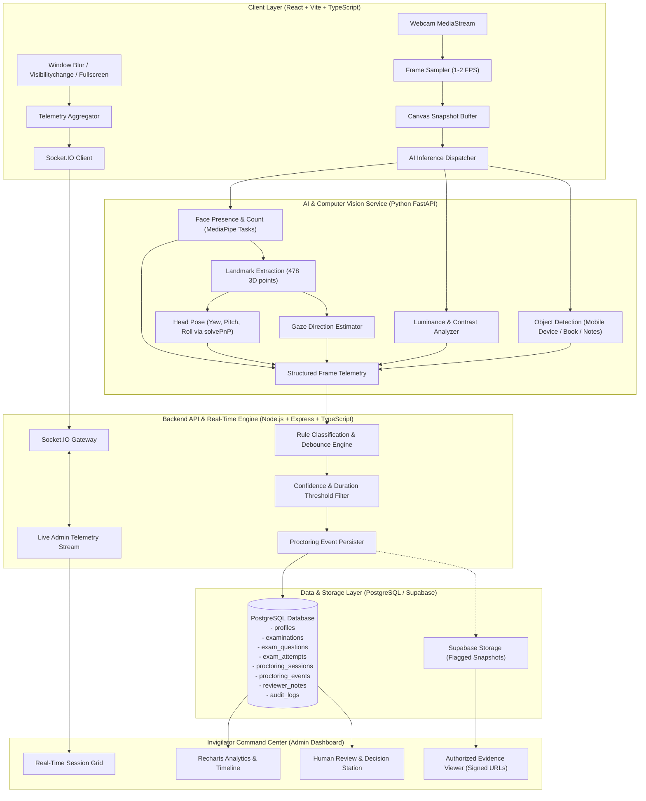

# AI-Powered Online Examination Proctoring Platform: Architecture & Engineering Plan

## 1. Executive Summary

This architecture implements an enterprise-grade, human-in-the-loop AI proctoring system. The platform strictly enforces that **AI outputs are evidentiary signals for human invigilator review, never automated accusations or disqualifications**.

The system balances student privacy, low-latency client-side responsiveness, server-side rule verification, and rich analytics for exam administrators.

---

## 2. High-Level System Architecture



---

## 3. Data Flow & Event Processing Pipeline

1. **Pre-flight & Consent**:
   - The student completes device diagnostics (camera feed, microphone activity meter, viewport resolution, network check).
   - The student signs an ethical proctoring disclosure clarifying what is processed (landmark coordinates, presence) and what is not (biometrics/identity matching, covert surveillance).
2. **Adaptive Frame Ingestion**:
   - The frontend samples frames at a configurable frequency (default: 1.5s interval / ~0.67 FPS).
   - Frames are compressed client-side to JPEG (quality: 0.75, resolution: 640x480) to minimize bandwidth.
3. **Multi-Task Vision Analysis**:
   - `Face Presence`: Calculates face count and bounding box.
   - `Lighting Quality`: Computes average luminance and root-mean-square contrast. Prevents reporting absence if the scene is underexposed.
   - `Head Pose`: Uses 6 fiducial 3D facial landmarks (`P3D_MODEL`) solved via Levenberg-Marquardt `cv2.solvePnP` to yield Euler angles (yaw, pitch, roll).
   - `Object Detection`: Identifies high-risk peripheral objects (mobile devices, books, secondary screens) with confidence tracking.
4. **Sliding-Window Rule Engine**:
   - The Rule Engine maintains a time-windowed state machine for each active session:
     - `NO_FACE_DETECTED`: Requires no face continuously for $> 10$ seconds (ignores 1-2s occlusion or head movement).
     - `MULTIPLE_FACES_DETECTED`: Requires $\ge 2$ faces across 3 consecutive frames with confidence $> 0.65$.
     - `HEAD_POSE_DEVIATION`: Requires $|\text{yaw}| > 25^\circ$ or $|\text{pitch}| > 20^\circ$ sustained for $> 5$ seconds.
     - `BROWSER_FOCUS_LOST`: Fired immediately upon `document.visibilitychange` or `window.blur` exceeding 2 seconds.
5. **Real-Time Distribution & Recording**:
   - Confirmed events are saved to PostgreSQL with UUIDs, duration, confidence, model version, and optional thumbnail URL.
   - Emitted via Socket.IO room `exam:{examId}` directly to connected human invigilators.
   - Non-accusatory technical feedback is displayed to the student (e.g. *"Please center your face in the camera view"*).
6. **Invigilator Review Workflow**:
   - Administrators view live status chips (`Normal`, `Attention`, `Review Required`, `Technical Issue`).
   - Flagged incidents open in an Evidence Viewer displaying the captured snapshot, confidence, and timestamps.
   - Human invigilators classify incidents as `Reviewed — no concern`, `Requires follow-up`, or `Technical issue` with audit notes.

---

## 4. Repository Structure

```
aiproctor/
├── ai/                           # Custom Machine Learning Pipeline
│   ├── training/                 # Dataset builder, YOLO training loop, evaluation & export
│   │   ├── configs/              # Hyperparameters and data YAML configs
│   │   ├── scripts/              # build_dataset, train, evaluate, export, model_registry
│   │   └── artifacts/            # Model checkpoints, ONNX/TorchScript models, evaluation report
│   └── inference/                # Production standalone inference service & tests
├── ai-service/                   # Primary Python FastAPI Computer Vision Service
│   ├── app/
│   │   ├── core/config.py        # Vision thresholds, model paths
│   │   ├── detectors/
│   │   │   ├── face_detector.py  # Face count & presence detection
│   │   │   ├── head_pose.py      # 3D Head pose (solvePnP Euler angles)
│   │   │   ├── lighting_analyzer.py # Luminance & contrast check
│   │   │   └── object_detector.py# Peripheral device detector
│   │   ├── engine/analyzer.py    # Pipeline coordinator & telemetry packer
│   │   ├── evaluation/benchmark.py# Accuracy, latency & lighting evaluator
│   │   └── main.py               # FastAPI application & endpoints
│   ├── models/                   # Official MediaPipe models (downloaded)
│   ├── tests/                    # Unit tests for CV algorithms
│   └── requirements.txt
├── backend/                      # Node.js + Express + TypeScript Core
│   ├── src/
│   │   ├── config/env.ts         # Environment validation
│   │   ├── db/
│   │   │   ├── client.ts         # PostgreSQL/Supabase database client
│   │   │   └── schema.ts         # Schema definition & types
│   │   ├── rule-engine/
│   │   │   ├── types.ts          # Event rules, thresholds, severity
│   │   │   └── engine.ts         # State-machine rule evaluator
│   │   ├── routes/
│   │   │   ├── exams.ts          # Exam attempts, questions, submissions
│   │   │   ├── proctoring.ts     # Session lifecycle & event ingestion
│   │   │   └── admin.ts          # Invigilator dashboard & review endpoints
│   │   ├── socket/gateway.ts     # Real-time WebSockets
│   │   ├── app.ts                # Express application setup
│   │   └── server.ts             # Server entry point
│   ├── tests/                    # Rule engine & API test suite
│   ├── package.json
│   └── tsconfig.json
├── frontend/                     # React + Vite + TypeScript + Tailwind
│   ├── src/
│   │   ├── components/
│   │   │   ├── exam/             # Student examination components
│   │   │   │   ├── SystemCheck.tsx
│   │   │   │   ├── ConsentModal.tsx
│   │   │   │   ├── WebcamMonitor.tsx
│   │   │   │   ├── QuestionPalette.tsx
│   │   │   │   └── ExamWorkspace.tsx
│   │   │   └── admin/            # Administrator command center
│   │   │       ├── AdminDashboard.tsx
│   │   │       ├── ActiveSessionsGrid.tsx
│   │   │       ├── SessionDetailModal.tsx
│   │   │       ├── EvidenceViewer.tsx
│   │   │       └── AnalyticsCharts.tsx
│   │   ├── hooks/                # Camera, telemetry & exam state hooks
│   │   ├── services/             # Axios API client & Socket.IO gateway
│   │   └── App.tsx               # Route coordinator & role switcher
│   ├── package.json
│   └── vite.config.ts
├── supabase/
│   └── migrations/
│       └── 001_initial_proctoring_schema.sql # Complete PostgreSQL DDL with RLS
└── docs/                         # Architecture, evaluation, & API contracts
```

