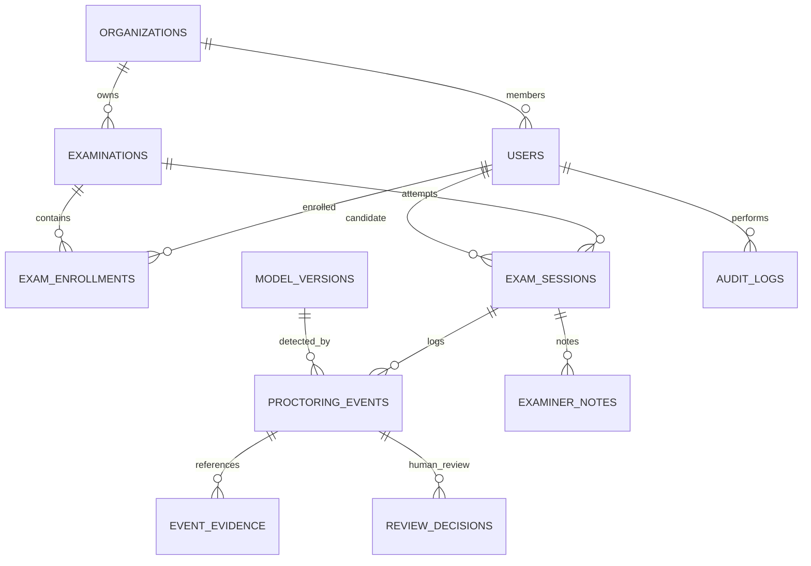

# Database Schema & Entity Relational Specification

The database architecture is built for PostgreSQL and Prisma ORM, enforcing strict normalized entity relationships, audit logging, and role-based security boundaries.

## 1. Entity Relational Diagram

## 2. Table Specifications

### `users`
- `id` (UUID PK): Unique candidate or staff identifier.
- `org_id` (UUID FK): Organization tenant.
- `email` (VARCHAR Unique): Institutional email.
- `role` (ENUM): `STUDENT`, `INVIGILATOR`, `ADMINISTRATOR`.
- `student_id` (VARCHAR): Institutional student registration code.

### `examinations`
- `id` (UUID PK): Unique examination identifier.
- `title` (VARCHAR): Course examination title.
- `course_code` (VARCHAR): e.g. `CS-402`.
- `duration_minutes` (INT): Total exam duration.
- `status` (ENUM): `DRAFT`, `PUBLISHED`, `IN_PROGRESS`, `COMPLETED`, `ARCHIVED`.
- `permitted_materials` (TEXT[]): List of authorized materials (`calculator`, `book`, etc.).
- `config` (JSONB): Thresholds for no-face timeout, yaw angles, and sample rates.

### `exam_sessions`
- `id` (UUID PK): Unique attempt session.
- `exam_id` (UUID FK): Reference to `examinations`.
- `user_id` (UUID FK): Reference to `users`.
- `status` (ENUM): `INITIALIZED`, `ACTIVE`, `PAUSED`, `INTERRUPTED`, `COMPLETED`.
- `client_ip` (VARCHAR): Candidate IP address.
- `user_agent` (TEXT): Browser and operating system metadata.
- `heartbeat_at` (TIMESTAMPTZ): Continuous connectivity heartbeat.
- `score` (FLOAT): Evaluated marks.

### `proctoring_events`
- `id` (UUID PK): Server-generated event ID.
- `session_id` (UUID FK): Reference to `exam_sessions`.
- `model_version_id` (UUID FK): Tracking which model generated the observation.
- `event_type` (VARCHAR): `NO_FACE_DETECTED`, `MULTIPLE_FACES_DETECTED`, `HEAD_POSE_DEVIATION`, `SUSPICIOUS_OBJECT_DETECTED`, `BROWSER_FOCUS_LOST`, `CAMERA_DISCONNECTED`.
- `observed_at` (TIMESTAMPTZ): Observation timestamp.
- `duration_ms` (INT): Duration of anomaly before dispatch.
- `confidence` (FLOAT): Model confidence score ($0.0 \le c \le 1.0$).
- `severity` (ENUM): `LOW`, `MEDIUM`, `HIGH`, `TECHNICAL`.
- `review_status` (ENUM): `PENDING`, `REVIEWED`, `DISMISSED`, `NEEDS_FOLLOW_UP`.
- `metadata` (JSONB): Euler angles, bounding box coordinates, lighting luminance, etc.

### `model_versions`
- `id` (UUID PK): Model registry entry.
- `model_identifier` (VARCHAR): e.g. `yolo-exam-detector`.
- `version` (VARCHAR): e.g. `v1.0.524`.
- `artifact_checksum` (VARCHAR): SHA256 file digest.
- `training_config` (JSONB): Hyperparameters, learning rate, optimizer.
- `evaluation_metrics` (JSONB): Precision, recall, mAP@50, latency.
- `is_active` (BOOLEAN): Current production flag.

### `review_decisions`
- `id` (UUID PK): Formal reviewer determination.
- `session_id` (UUID FK): Exam session reference.
- `event_id` (UUID FK): Flagged event reference.
- `reviewer_id` (UUID FK): Invigilator who rendered the judgment.
- `status` (ENUM): Final human determination.
- `conclusion` (TEXT): Mandatory audit reasoning.

